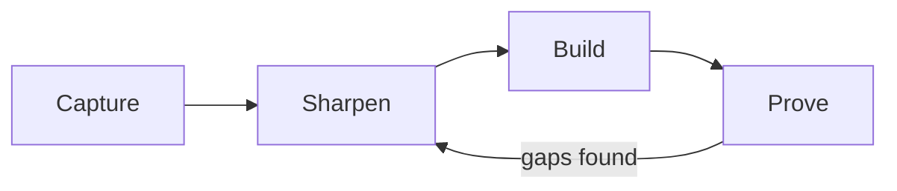

# Notebook of Things I Don't Know About

This is a notebook of things that, you guessed it, I don't know about ... yet!

## Why

This notebook of mine is inspired by Richard Feynman as a way to break my habits of being overly reliant on references or AI to solve my own problems. Anything I find myself asking questions about in my field will end up here for me to solve myself.

The whole point is to deepen my knowledge of the tech world. These questions will mostly be about topics like coding, software engineering, system design, AI/Machine Learning, and any other closely related topics.

## How it Works

1. Capture: Write any question that pops into my head down in my physical notebook
2. Sharpen: Run the question in my head trying to break it down and come up with predictions for what might happen.
3. Build: Jump right in after predictions are set trying to build out what I came up with in the sharpen stage. Make sure to test everything while building.
4. Prove: Prove I really understand what I learned in the previous steps by passing the mastery standard below

**Mastery standard:** an entry is only checked off when I can do these 3 things

1. Build out the solution from scratch with no outiside help or resources of any kind
2. Can plainly explain or teach the solution to anyone
3. Can accuratelly predict what will happen in new cases before running anything

## Rules

- No copying code from any source. Must write everything by hand
- A minimum of 30 minutes should be spent trying to solve a problem before looking for hints
- AI is allowed, but only as a tutor that helps hint in the right direction when lost, not a way to just copy code with no understanding
- Always write and commit predictions before any code is written, these are where you find gaps in your knowledge

## Entries

| ID   | Question                       | Topic           | Status   | Folder                       |
| ---- | ------------------------------ | --------------- | -------- | ---------------------------- |
| N001 | How do arrays work underneath? | Data Structures | Building | [link](./N001-dynamic-array) |

## Favorite Problems

This is just a list of my favorite 3 open questions I keep coming back to.

1. How do neural networks identify patterns? How does a simple math equation hundreds or thousands of times find complex patterns in data?
2. What are the current gaps or bottlenecks with current AI training methods?
3. How are programming languages built? Are they written in other languages or are they started with something so low level like assembly or machine code?
